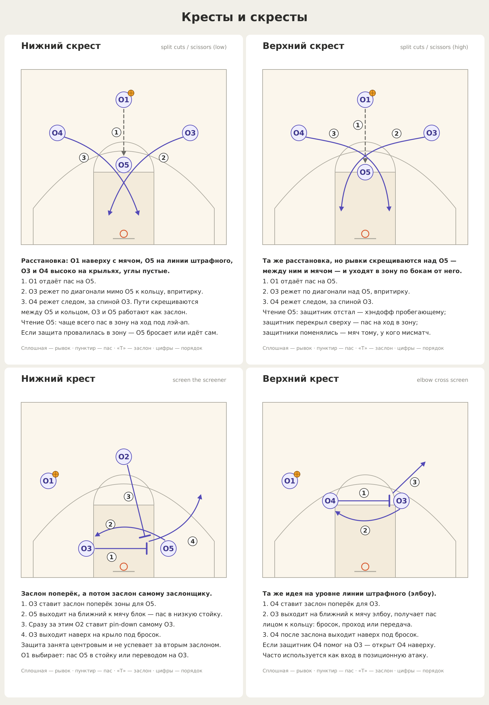
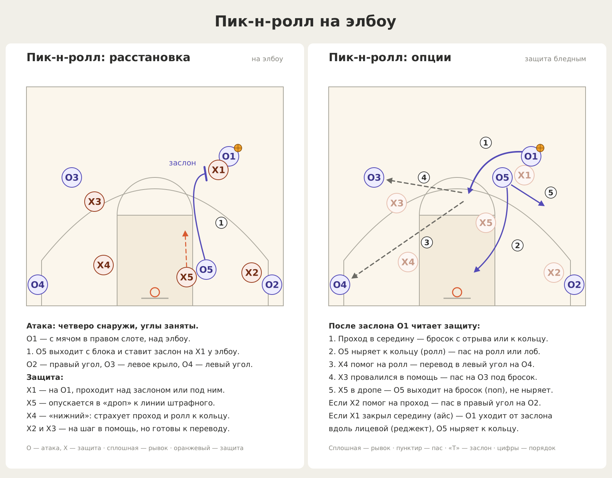
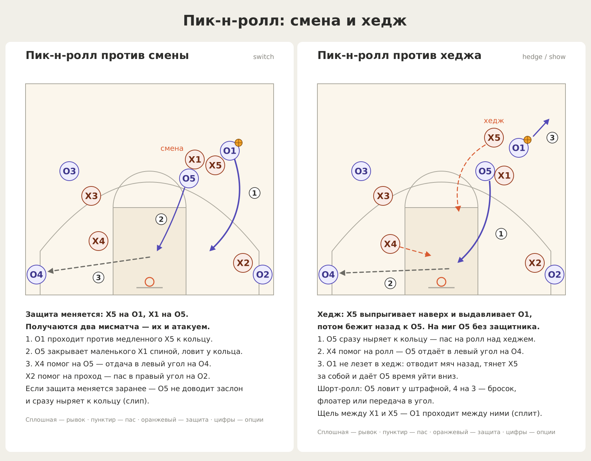
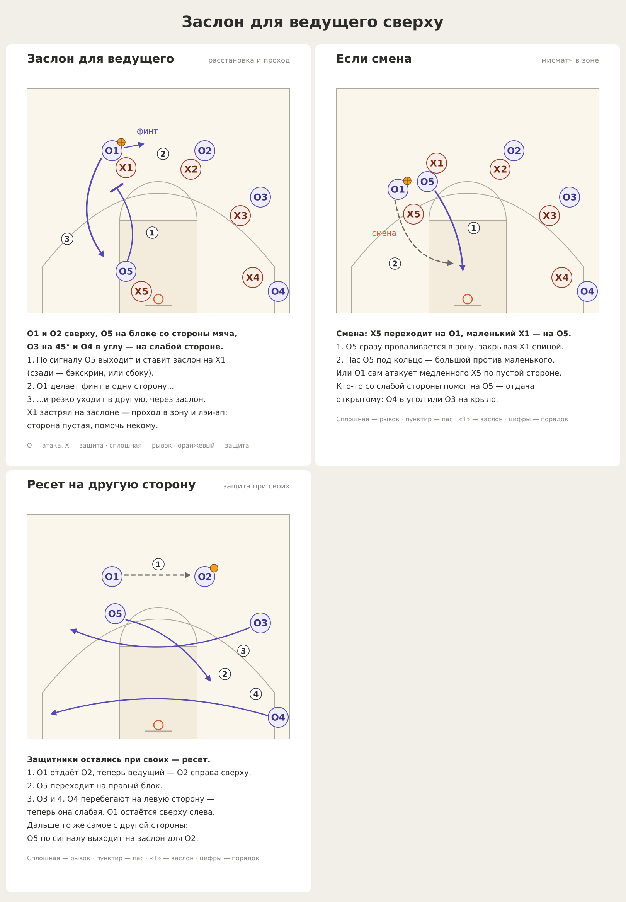
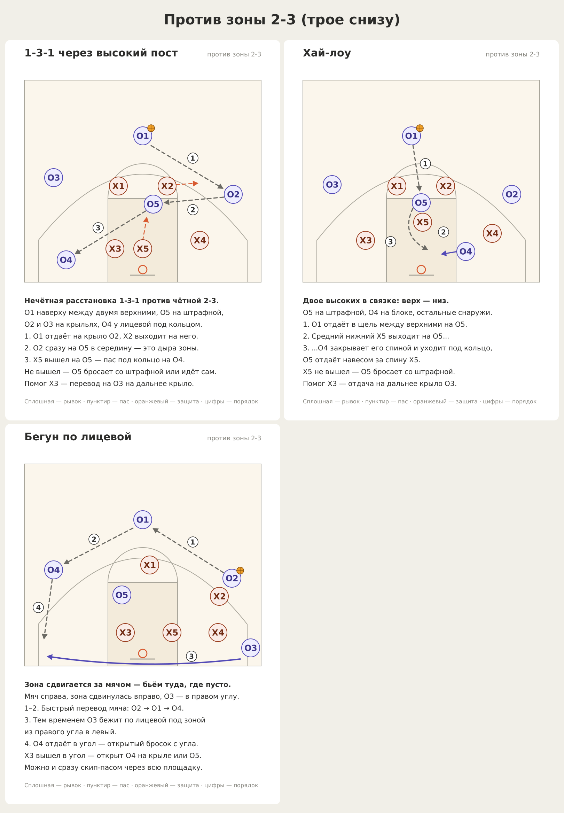
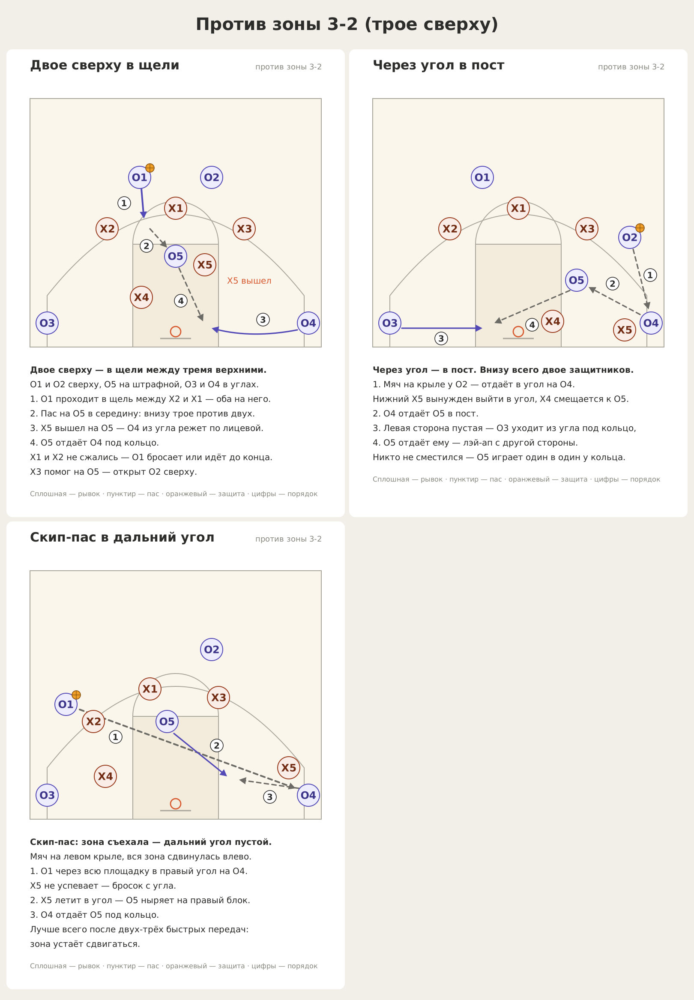
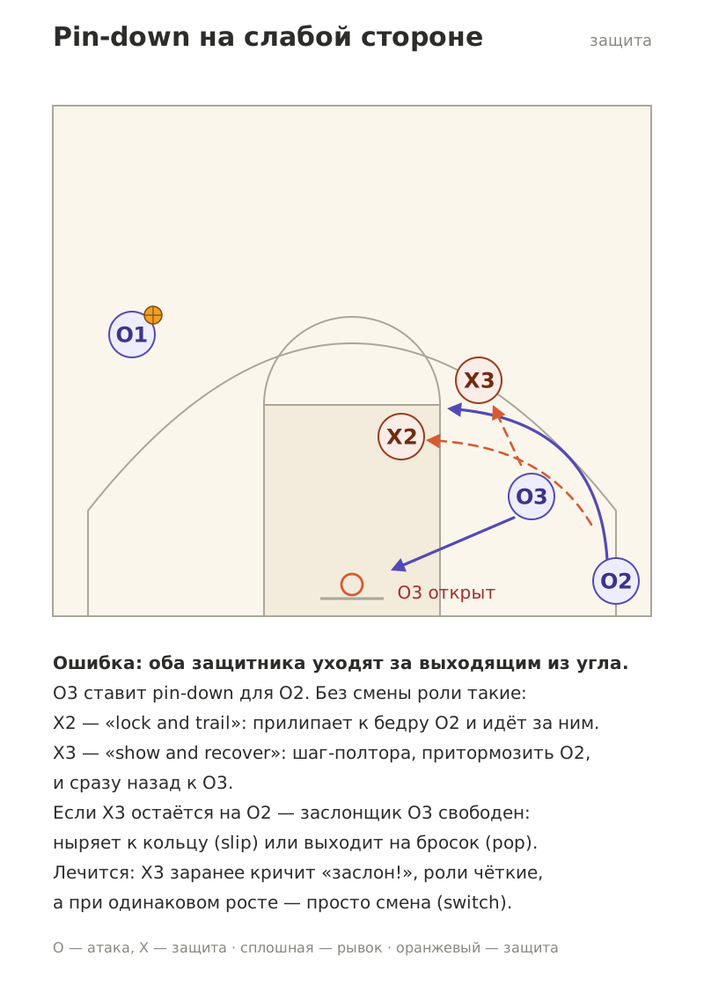

# Баскетбольная тактика

Схемы комбинаций с описаниями. Каждую картинку можно открыть и переслать как есть.

## Содержание

### ⚔️ Атака

| Комбинация | Против чего | Что внутри |
|---|---|---|
| [Кресты и скресты](#кресты-и-скресты) | Личная защита | Ножницы через высокий пост, заслон поперёк, screen the screener |
| [Пик-н-ролл на элбоу](#пик-н-ролл-на-элбоу) | Личная защита: дроп, смена, хедж | Расстановка, опции атаки, ответ на каждый вариант защиты |
| [Заслон для ведущего сверху](#заслон-для-ведущего-сверху) | Личная защита | Заслон с блока, проход по пустой стороне, смена, ресет |
| [Против зоны 2-3](#зона-2-3-трое-снизу) | Зона 2-3 (трое снизу) | 1-3-1 через высокий пост, хай-лоу, бегун по лицевой |
| [Против зоны 3-2](#зона-3-2-трое-сверху) | Зона 3-2 (трое сверху) | Двое в щели, через угол в пост, скип-пас |

### 🛡️ Защита

| Тема | Против чего | Что внутри |
|---|---|---|
| [Pin-down на слабой стороне](#pin-down-на-слабой-стороне) | Заслон без мяча (down screen) | Частая ошибка без смены и как её исправить |

**Обозначения:** O1–O5 — атака, X — защита. Сплошная стрелка — рывок или проход, пунктир — пас, линия с «Т» на конце — заслон (упирается в защитника, на которого его ставят), оранжевым — движение защиты, цифры в кружках — порядок действий или номер опции.

---

# ⚔️ Атака

## Против личной защиты

### Кресты и скресты

**Против:** личной защиты.



| Схема | Суть | По-английски |
|---|---|---|
| [Нижний скрест](diagrams/01-lower-scissors.png) | Пас на O5 на линию штрафного, O3 и O4 по очереди режут крест-накрест между O5 и кольцом | split cuts, scissors |
| [Верхний скрест](diagrams/02-upper-scissors.png) | То же, но рывки скрещиваются над O5, ближе к мячу; удобнее хэндофф | split cuts, scissors |
| [Нижний крест](diagrams/03-lower-cross.png) | Заслон поперёк под кольцом для центрового, затем pin-down самому заслонщику | screen the screener |
| [Верхний крест](diagrams/04-upper-cross.png) | Заслон поперёк на уровне элбоу, заслонщик выходит наверх | elbow cross screen |

### Пик-н-ролл на элбоу

**Против:** личной защиты — отдельно разобраны дроп, смена и хедж.





| Схема | Против чего | Суть |
|---|---|---|
| [Расстановка](diagrams/06-elbow-pnr-setup.png) | Дроп | Где стоят все десять игроков: O5 ставит заслон на X1 у элбоу, X5 в дропе, X4 страхует снизу |
| [Опции](diagrams/07-elbow-pnr-options.png) | Дроп | Проход, ролл, поп, переводы в угол и на крыло — в зависимости от того, кто помогает |
| [Против смены](diagrams/08-elbow-pnr-vs-switch.png) | Смена (switch) | Два мисматча: проход против большого, игра в посту против маленького, слип |
| [Против хеджа](diagrams/09-elbow-pnr-vs-hedge.png) | Хедж (hedge / show) | Быстрый пас на ролл, шорт-ролл 4 на 3, отвод мяча, сплит |

### Заслон для ведущего сверху

**Против:** личной защиты.



| Схема | Суть |
|---|---|
| [Расстановка и проход](diagrams/10-side-screen-setup.png) | O1 и O2 сверху, слабая сторона перегружена. O5 с блока ставит заслон на X1, O1 финтит и уходит через заслон по пустой стороне на лэй-ап |
| [Если смена](diagrams/11-side-screen-switch.png) | O5 проваливается в зону против маленького X1, O1 отдаёт под кольцо или атакует большого |
| [Ресет на другую сторону](diagrams/12-side-screen-reset.png) | Защита осталась при своих: пас на O2, все переходят на другую сторону, и всё повторяется |

## Против зонной защиты

Главное правило: ставить расстановку, обратную зоне. Против двух сверху — одного, против трёх сверху — двоих. Быстро переводить мяч, проходить в щели, бросать из углов и обязательно идти на подбор.

### Зона 2-3 (трое снизу)

**Против:** зоны 2-3 — двое защитников сверху, трое снизу.



| Схема | Суть |
|---|---|
| [1-3-1 через высокий пост](diagrams/13-zone-131-high-post.png) | Нечётная расстановка против чётной: мяч на крыло, потом в середину на штрафную, оттуда под кольцо |
| [Хай-лоу](diagrams/14-zone-high-low.png) | O5 ловит на штрафной, средний нижний выходит — O4 закрывает его спиной и получает навесом |
| [Бегун по лицевой](diagrams/15-zone-baseline-runner.png) | Быстрый перевод мяча, снайпер пробегает под зоной в дальний угол |

### Зона 3-2 (трое сверху)

**Против:** зоны 3-2 — трое защитников сверху, двое снизу.



| Схема | Суть |
|---|---|
| [Двое сверху в щели](diagrams/16-zone32-gaps.png) | Чётная расстановка против нечётной: проход в щель, пас в середину, внизу трое против двух |
| [Через угол в пост](diagrams/17-zone32-corner-post.png) | Мяч в угол вытаскивает нижнего защитника — пас в пост, оттуда на дальний блок |
| [Скип-пас в дальний угол](diagrams/18-zone32-skip.png) | Зона съехала к мячу — передача через всю площадку в пустой угол |

---

# 🛡️ Защита

### Pin-down на слабой стороне

**Против:** заслона без мяча на слабой стороне (down screen).



Частая ошибка без смены: оба защитника уходят за игроком, который выходит из угла, и заслонщик остаётся открытым. Как правильно: X2 прилипает к своему игроку и идёт за ним, X3 на шаг показывает себя и сразу возвращается к заслонщику. При одинаковом росте проще всего поменяться.

---

## Как перерисовать

Все схемы генерируются одним скриптом. Чтобы поправить или добавить схему, правки вносятся в [`tools/make_diagrams.py`](tools/make_diagrams.py):

```bash
pip install cairosvg
python3 tools/make_diagrams.py
```
